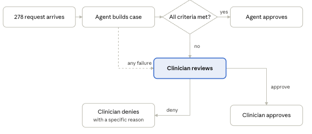

# prior-auth-agentcore

Reference implementation for the article **"Build the Case, Let the Clinician Decide."**

An agent on Amazon Bedrock AgentCore assembles a prior-authorization case: it gathers the evidence, checks it, and cites every statement. A clinician makes the decision.

The agent's gateway has no tool for an adverse determination. That tool lives on a separate reviewer gateway, which admits clinicians only and where a Cedar policy forbids the action for the agent's identity. The agent may submit an approval, but the approval service records it only after re-running every check on the stored packet itself.

*"Agent approves" means: the model only gathers and cites; `decide()` approves, and the approval service re-checks the stored packet before recording it. In this demo the request is a synthetic case record, not an X12 278 transaction.*

## Start here

If you have ten minutes, read in this order:

1. **The article:** [docs/article-draft.md](docs/article-draft.md). It makes the claims; this repository backs them.
2. **The demo:** six beats, run with `make demo BEAT=<1-6>`. Identifiers on screen are masked by default, so any run can be recorded.

   | Beat | What it shows                                                                                                                    | Status                                                                              |
   | ---- | -------------------------------------------------------------------------------------------------------------------------------- | ----------------------------------------------------------------------------------- |
   | 1    | Both gateways side by side: the agent's five case-building tools and no denial tool; the reviewer gateway's clinician-only tools | **Proven**                                                                          |
   | 2    | The Strands agent (three gathering tools, Nova Pro) builds a cited packet; `decide()` approves                                   | **Shown on the deployed system.** Rows proven, except G8 and G11 (deferred: mutation run, evidence-rule redesign) and B7 (recorded, not tested locally) |
   | 3    | One note removed: routed to the reviewer, gap marked                                                                             | **Proven** |
   | 4    | The agent refused at the reviewer gateway, first by the authorizer, then by Cedar                                                | **Proven**                                                                          |
   | 5    | A clinician decides with the same tool the agent was refused; the decision record chains to the recommendation                   | **Shown on the deployed system** with a scripted clinician sign-in; the hosted-UI sign-in by a person is pending (B8) |
   | 6    | A trace with no chart text: a canary scan with a positive control                                                                | **Partial:** the trace content is proven (L1); the canary scan covers normal, refusal and clinician-decision paths, not injected error paths (L2) |

   The harness: six cases × Nova Pro and Sonnet 4.6 × three trials, pre-registered in [evaluation/PREREGISTRATION.md](evaluation/PREREGISTRATION.md), reported in [evaluation/report.md](evaluation/report.md).

   **Sample outputs:** [SAMPLE_OUTPUTS.md](SAMPLE_OUTPUTS.md) shows each beat's real output from the committed evidence.

3. **The claims ledger:** [openspec/claims-ledger.md](openspec/claims-ledger.md). One row per article claim, with the evidence that proves it and its status: proven, partial (with what's open), or deferred.
4. **The evidence:** [evidence/](evidence/). Redacted records from deployed runs: gateway configuration, policy text, live allowed and denied calls, chain verifications, canary scans, storage-control checks, the boundary smoke rerun after each boundary deploy, the independent reviews of IAM changes (`evidence/2026-10-16/reviews/`), and every deploy logged by commit in `evidence/deploys.jsonl`.

**Status:** all six demo beats run on the deployed system: the gateways, the Cedar policies, the Strands agent on AgentCore Runtime, the evidence store, and the clinician's decision. Some ledger rows are partial, and each names what's open. The article is published only after every row it relies on is proven.

## What this repository demonstrates

- **Two gateways.** The agent's gateway has no denial tool. The reviewer gateway rejects the agent's token at sign-in, and a Cedar `forbid` stands behind that. Both layers are shown with recorded denied calls.
- **The decision is code.** The model is given three gathering tools and returns citations only: document, page and line. Code fills each value from the trusted chart, and `decide()` is the only caller of the two tools that end a case.
- **Server-verified auto-approval.** `record_approval` takes a packet reference. The approval service rebuilds the verdict from trusted sources before recording anything, so a forged packet is refused.
- **A cited case packet**, with four checks run before anyone sees it: schema, source match, the criterion's evidence rule, and same patient.
- **Failure routing.** Every failure mode goes to a human reviewer or an operator alert, never to a default. Every session ends in exactly one outcome.
- **Clean telemetry.** Traces hold identifiers, timings and hashes. A canary scan, with a positive control, shows they contain no chart text.
- **Chained, write-once evidence records.** A decision record chains to its recommendation by a hash recomputed from the stored bytes.
- **A pre-registered evaluation** that reports the false auto-approval rate on counterfactual cases, with every trial shown.

## Repository map

| Path                       | What it holds                                                                                                             | Demo beat / ledger rows        |
| -------------------------- | ------------------------------------------------------------------------------------------------------------------------- | ------------------------------ |
| `infra/`                   | CDK app (`infra/app.py`): budgets, gateways, Cognito, policy engine, Cedar policies (`cedar.py`), runtime, evidence store | Beats 1–6 · B1–B6, A1–A4, M9   |
| `src/prior_auth/checks/`   | The four checks and `recompute()`, shared by `decide()` and the approval service                                          | Beats 2, 3 · G4–G8, G11        |
| `src/prior_auth/handlers/` | Lambda handlers: case tools, the approval service, reviewer tools, pre-token trigger                                      | Beats 1, 2, 5 · B6, B8         |
| `src/prior_auth/agent/`    | The Strands agent, the session wrapper, the case pipeline, telemetry settings                                             | Beats 2, 3, 6 · G10, F1–F7, A1 |
| `scripts/workbench.py`     | The clinician's local page (127.0.0.1), signing in through the Cognito hosted UI                                          | Beat 5 · B8, L3                |
| `data/`                    | Synthetic policies, charts and cases; `SYNTHETIC.md`                                                                      | Beats 2, 3, 6 · G1–G3          |
| `scripts/`                 | Deploy guard, teardown and verifier, `boundary_smoke.py`, evidence recorders, `verify_chain.py`, `canary_scan.py`, `demo.py` | All beats · guardrails · L2–L8 |
| `evidence/`                | Redacted, committed evidence from deployed runs                                                                           | All proven ledger rows         |
| `docs/`                    | Principles, AgentCore contract notes, the empty-output rules, the article draft                                           | B5, R1–R6                      |
| `openspec/`                | The claims ledger and the OpenSpec changes                                                                                | Definition of done             |
| `tests/`                   | The test suite, including the real-payer-name, redaction and consistency checks                                           | All rows typed `test`          |
| `evaluation/`              | The pre-registration, the runner, the raw trials and the one-page report                                                  | M1–M8                          |

## Commands

`make help` lists them. They use whatever `AWS_PROFILE` is set in your shell.

| Command | What it does |
|---|---|
| `make test` | The test suite |
| `make demo BEAT=1` | One demo beat, identifiers masked (`REDACT=0` to show them) |
| `make workbench` | The clinician's local page on 127.0.0.1:8765 |
| `make deploy STACK=PriorAuthRuntime` | One stack, only through the deploy guard: clean tree, budgets present, exact gateway IDs, each deploy logged by commit |
| `make smoke` | The boundary checks, compared with the recorded evidence |
| `make verify-chain CASE=… RUN=…` | One decision's chain: decision → recommendation → runtime span, and decision → trace |
| `make report` | Regenerates `evaluation/report.md` and `SAMPLE_OUTPUTS.md` from committed data |
| `make scan` | The gate before going public: deployment identifiers and restricted terms in the tree and the full history, with a positive control |

Teardown is not a make target: it runs once, deliberately, with `python -m scripts.teardown --yes`.

## Principles

See [docs/principles.md](docs/principles.md).

## Why there is no Knowledge Base

A decision gate needs a verified criterion, not a retrieved one. Payer criteria are compiled and verified upstream, once. Each criterion carries its policy version, its source location and an evidence rule. At decision time the agent looks them up by exact match on (payer, CPT). Retrieval over a vector store is the right tool for open-ended questions; here it would add a step that can return the wrong criterion.

## Production notes

This repository is a reference implementation that can be torn down the same day. A production deployment would differ in at least two ways:

- **The runtime runs in VPC mode.** The demo uses public mode behind a JWT authorizer.
- **The evidence store uses Object Lock in compliance mode,** with the retention its records policy requires. The demo uses governance mode so it can be torn down the same day.

## Threat model

**Inside the trust boundary.** AWS account administrators. They can change any control here, including the Cedar policies. The controls are aimed at the agent and at callers outside the account.

**The boundary the article describes.** It holds at three points:

- **The agent's gateway** has no denial tool.
- **The reviewer gateway** admits only the clinician app client, and only tokens carrying the clinician role.
- **The Cedar policies** forbid the denial action for every non-clinician, and explicitly for the agent.

**Residual risks, stated plainly:**

- **Direct Lambda invocation.** A principal in the account allowed to call `lambda:InvokeFunction` can invoke the tool Lambdas directly and skip both gateway layers. Gateway does not pass the caller's identity to Lambda targets, so the denial Lambda cannot verify the clinician itself. This does not let anyone forge an approval: `record_approval` rebuilds every verdict from trusted sources, whatever the call path.
- **Reviewer identity.** The decision record names the reviewer as the clinician app reports it. The gateway checks that the caller is a clinician, but not which clinician the record names. A request interceptor that validates the token and overwrites the identity is planned in [`post-monday-hardening`](openspec/changes/post-monday-hardening/proposal.md).
- **Governance mode.** The evidence store uses Object Lock in governance mode, and only the teardown role may bypass it. Production would use compliance mode.

## Known limitations

This repository is built backwards from a five-minute demo. These are deliberately out of scope, and each one is planned in [`openspec/changes/post-monday-hardening`](openspec/changes/post-monday-hardening/proposal.md).

- **Reviewer identity is reported, not verified.** See the threat model above.
- **One tenant.** The tenant groups exist in Cognito, but nothing is scoped by them: no tenant-scoped prefixes, no cross-tenant tests, and no per-tenant keys. The workbench page reads the review queue with the operator's local AWS credentials. Only decisions go through the reviewer gateway under the clinician's token.
- **Evidence rules are narrow.** They cover the demo cases. Adversarial review found further gaps that would let a negated or hedged line count as support:
  - negators outside the list ("w/o", "neg.", "cannot confirm", typographic apostrophes, fullwidth or zero-width characters)
  - negation in a section header above the line
  - planned or ordered therapy counted as completed

  The fix is an allow-list design: whole-line templates in allowed sections, NFKC normalization and invisible-character removal.

- **Telemetry error paths are not yet scanned.** The canary scan covers normal runs and the refusals for forged and wrong-patient cases, not injected exceptions.
- **Operator alerting is a metric and a CloudWatch alarm.** There is no SNS topic; the alarm's state change is the evidence.
- **Memory is not used,** and no Memory evidence is recorded. **No Knowledge Base:** policy lookup is an exact match on (payer, CPT).
- **The decision clock** is tested against the 7-day and 72-hour windows only, not edge cases.
- **No redeploy-from-scratch test.** A verified teardown runs after the demo period.
- **No mutation testing** of the checks module.
- **Some storage refusals are simulated.** The runtime and tool roles trust only their service principals, so their refusals (writes to `decisions/`, deletes, retention changes, governance bypass, another KMS key) are evaluated with the IAM policy simulator against the deployed bucket policy, not by live calls. Write-once is shown live.
- **Governance mode, with one bypass role.** The teardown role (assumable by account administrators) can delete every version of a record and so let a different one be created on the same run. Nobody else can delete, hide or replace a record. Production uses compliance mode.
- **The workbench is a local demo page.** Sessions live in memory; it serves one operator on 127.0.0.1.
- **Direct Lambda invocation** by account administrators bypasses both gateway layers (see the threat model above).

## Data

This repository uses synthetic data only. It contains no real patient data, and it must never be used with any.
